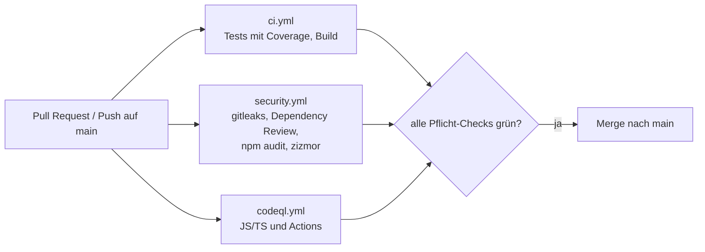

# Erklärung der CI/CD-Workflows — Videoflix Frontend

> Jeden Schritt so erklären können, dass er im Gespräch trägt. Bei jeder Workflow-Änderung mitpflegen.

## Gesamtüberblick

Bei jedem Pull Request und jedem Push auf `main` laufen drei Workflows parallel: **CI** (Tests und Build),
**Security Checks** (Secrets, Abhängigkeiten, Workflow-Lint) und **CodeQL** (statische Code-Analyse).
Ein Merge nach `main` ist nur über einen PR möglich; die Pflicht-Checks stehen im Ruleset `main-protection`.
Ein Image und ein Deployment gibt es noch nicht: Das Image baut später diese CI, ausgerollt wird aus dem
eigenen Repo `videoflix-deploy` per Digest.

## Gemeinsame Grundsätze

- **Actions per Commit-SHA gepinnt**, die Version steht als Kommentar daneben. Ein Tag wie `v7` kann
  nachträglich auf anderen Code zeigen (so geschehen beim Angriff auf `trivy-action` im März 2026), ein SHA nicht.
- **Neue Versionen frühestens nach 14 Tagen.** Wird ein Release kompromittiert, fällt das meist in den ersten
  Tagen auf; die Wartezeit hält solche Versionen fern.
- **`permissions: contents: read`** als Standard; Schreibrechte bekommt nur der Job, der sie braucht.
- **`persist-credentials: false`** beim Checkout: Der Token bleibt nicht in `.git/config` liegen, wo spätere
  Schritte ihn auslesen könnten.
- **`concurrency` mit `cancel-in-progress`**: Ein neuer Push bricht den veralteten Lauf ab.
- **`timeout-minutes`** je Job: Ein hängender Lauf verbraucht nicht sechs Stunden Runner-Zeit.

## 1. ci.yml

### 1.1 Auslöser
Push auf `main` und Pull Requests gegen `main`.

### 1.2 Job `test` — Test and build
1. **Node 22** mit npm-Cache. Angular 19 unterstützt Node 24 noch nicht; die Version steigt mit dem Angular-Upgrade.
2. **`npm ci`** installiert exakt den Stand aus `package-lock.json` (reproduzierbar, anders als `npm install`).
3. **Tests mit Coverage** in Headless-Chrome (`ChromeHeadlessCI` aus `karma.conf.js`). `--no-sandbox` ist nötig,
   weil das Runner-Image die Chrome-Sandbox per Kernel-Einstellung blockiert; die Tests laden nur eigenen Code.
4. **Coverage-Sperrklinke:** `karma.conf.js` → `coverageReporter.check` enthält die Startwerte vom
   2026-10-31 (abgerundet). Sinkt die Abdeckung darunter, schlägt der Lauf fehl. Steigt sie, werden die Werte
   angehoben, nie gesenkt.
5. **Produktions-Build:** Mit `strict` und `strictTemplates` ist der Build zugleich die Typprüfung für
   TypeScript und Templates.

## 2. security.yml

### 2.1 Job `secret-scan` (gitleaks)
Prüft die **gesamte Historie** (`fetch-depth: 0`), nicht nur den letzten Commit. Ein einmal committetes
Secret bleibt in der Historie, auch wenn es später gelöscht wird.

### 2.2 Job `dependency-review`
Nach dem GitHub-Starter-Workflow. Läuft nur bei PRs und **blockiert, wenn der PR eine Abhängigkeit mit
bekannter Lücke hinzufügt oder anhebt**. Bestehende Lücken ignoriert er; deshalb ist er heute schon ein
sinnvoller Pflicht-Check. Einen Kommentar im PR schreibt er nur bei einem Fund.

### 2.3 Job `npm-audit` (nur Bericht)
Meldet alle bekannten Lücken im Bestand als Warnung, schlägt aber nicht fehl. Die Funde betreffen Angular 19;
behoben werden sie mit dem Major-Upgrade. Danach wird der Job blockierend.

### 2.4 Job `workflow-lint` (zizmor)
Prüft die Workflows selbst: Template-Injection, zu weite Rechte, ungepinnte Actions, liegengebliebene Tokens.
Die Tool-Version ist fest (`1.31.1`), Befunde lassen den Job fehlschlagen.

## 3. codeql.yml

Nach dem GitHub-Starter-Workflow „CodeQL Advanced“. Analysiert **JavaScript/TypeScript** und die
**GitHub-Actions-Workflows**, ohne Build (`build-mode: none`). Läuft bei PRs, auf `main` und wöchentlich
(montags), damit neue Abfragen auch alten Code prüfen. Ergebnisse erscheinen unter *Security → Code scanning*.

## Die professionelle Kurz-Erklärung

Jeder PR durchläuft Tests mit einer Coverage-Sperrklinke, einen Produktions-Build als Typprüfung, einen
Secret-Scan über die ganze Historie, eine Prüfung neuer Abhängigkeiten und CodeQL. Die Workflows prüft zizmor
auf typische Angriffsmuster. Alle Actions sind per SHA gepinnt, neue Versionen kommen erst nach 14 Tagen, und
jeder Job hat nur die Rechte, die er braucht. Bekannte Lücken in Angular 19 werden bewusst nur gemeldet, weil
ihr Fix ein Major-Upgrade ist; Neues kommt trotzdem nicht hinzu. Als Nächstes: ESLint mit dem Angular-Upgrade,
dann Image-Build mit Push nach GHCR und Deploy per Digest.

## Was du fachlich erklären können solltest

- Warum Actions per SHA gepinnt werden und wozu die Wartezeit von 14 Tagen dient
- Was `persist-credentials: false` verhindert
- Unterschied Dependency Review (nur neue Lücken im PR) und `npm audit` (ganzer Bestand)
- Wie die Coverage-Sperrklinke funktioniert und warum die Werte nur steigen
- Warum der Produktions-Build hier auch Typprüfung ist
- Was zizmor findet, das CodeQL nicht findet (und umgekehrt)
